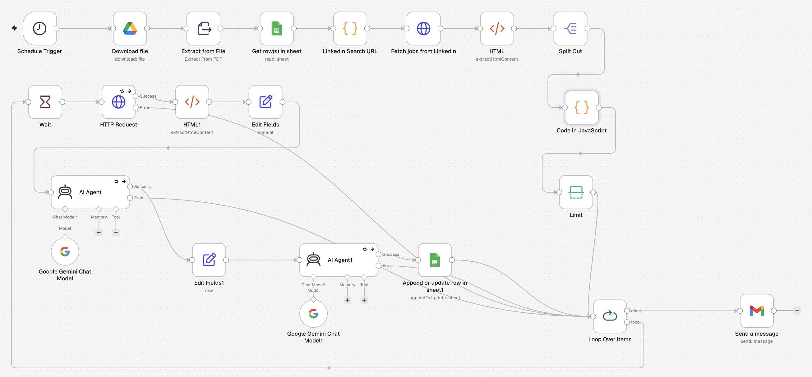

# AI Job Search Agent (n8n + Gemini)

An n8n workflow that runs every morning, collects new LinkedIn job posts that match my search filters, scores each one against my CV with two Gemini agents, and saves the results to a Google Sheet. When it finishes, it sends me an email.

## What it does

1. **Reads my CV** from Google Drive and extracts the text from the PDF.
2. **Reads the search filters** from a Google Sheet. Each row is one LinkedIn search: keyword, location, experience level, remote/hybrid/on-site.
3. **Builds one LinkedIn search URL per row**, limited to posts from the last 24 hours, and collects the job links.
4. **Filters and prioritizes jobs by title.** Off-target roles are dropped, and roles that mention my main stack (Vue, Node) go to the top.
5. **Limits the batch** so it stays inside the Gemini free-tier daily quota.
6. For each job, **two AI agents**:
   - **Job match**: analyzes the job description against my CV and returns a 0–100 score with evidence, gaps, and a tailored cover letter (strict JSON).
   - **Resume tips**: lists concrete, tagged changes to make the CV fit the role better.
7. **Saves everything** to a `Results` sheet: link, title, company, location, score, required skills, cover letter, improvements. Rows are matched on the job link, so a job seen twice is updated rather than duplicated.
8. **Sends a summary email** with a link to the sheet.

## Built on and changed

This workflow started from the *Job search ultimate workflow* template by **@jugaldb**. My changes:

- **Multiple searches**: the original read only the first filter row; it now builds one search per row.
- **Correct LinkedIn filter codes**: all experience levels (Internship → Executive) and work types are mapped, case-insensitive, with several values per cell (e.g. `Hybrid, On-site`). Keywords and locations are URL-encoded.
- **Title filter and priority** (`Filter & prioritize jobs`): drops irrelevant posts (e.g. "front office") and puts preferred-stack roles first, before any AI call is made.
- **Quota-aware design**: a `Limit` node and a 20-second `Wait` keep the run inside the Gemini free tier (each job uses 2 requests).
- **Error handling**: both agents retry 3 times; if a job still fails, its error output goes back to the loop, so one bad request no longer stops the whole run.
- **Personalized scoring prompt**: location, preferred stack and role type affect the score, and the cover letter is written in the language of the job post.
- **Cleaner sheet output**: required skills as a readable list, and the resume tips are actually saved.

## Setup

### 1. Google Sheet
Create a spreadsheet with two tabs.

**`Filters`**, one search per row:

| Keyword | Location | Experience Level | Remote | Easy Apply |
|---|---|---|---|---|
| Frontend Developer | Milan, Lombardy, Italy | Mid-Senior Level | Hybrid, On-site | |
| Vue.js | Italy | Mid-Senior Level | Remote | |

- **Experience Level**: `Internship`, `Entry level`, `Associate`, `Mid-Senior level`, `Director`, `Executive` (comma-separated for several).
- **Remote**: `On-site`, `Remote`, `Hybrid` (comma-separated for several).
- **Location**: use LinkedIn's English names (`Italy`, not `Italia`). The search runs without login from n8n's server, so an unrecognized location falls back to the server's country.

**`Results`**, header row only:

`Link | Title | Company | Location | Score | Cover Letter | Skills | Improvements`

### 2. Placeholders to replace
| Node | Field | Replace |
|---|---|---|
| Download CV | File URL | `YOUR_CV_FILE_ID`: your CV as a text-based PDF, shared as "Anyone with the link" |
| Read search filters / Save to Results sheet | Document | `YOUR_SHEET_ID` |
| Send summary email | To, Message | `your@email.com`, `YOUR_SHEET_ID` |
| AI Agent - Job match | Prompt → `CANDIDATE PREFERENCES` | `<YOUR CITY>`, `<YOUR COUNTRY>`, `<YOUR MAIN STACK>` |
| Filter & prioritize jobs | `relevant` / `priority` regex | keywords for your field |

### 3. Credentials
- **Google Drive, Google Sheets, Gmail**: OAuth2 ("Sign in with Google" on n8n Cloud).
- **Google Gemini (PaLM) API**: a free key from [Google AI Studio](https://aistudio.google.com/apikey). No billing needed.

### 4. Model and quota
Set the same model in both Gemini nodes. Check the requests-per-day limit for your model in AI Studio → **Rate limits** and size the `Limit` node so that `jobs × 2 < daily limit`. Free-tier quotas reset at midnight Pacific time, so the schedule runs at 09:30 (Europe/Madrid).

## Notes
- The workflow helps me **choose** where to apply; it does **not** apply automatically.
- LinkedIn job pages are fetched anonymously and in small numbers. LinkedIn's terms restrict automated access, so keep the volume low and use this for personal job searching only.

## Tech
n8n · Google Gemini API · LangChain AI Agent nodes · JavaScript (Code nodes) · Google Drive / Sheets / Gmail APIs
